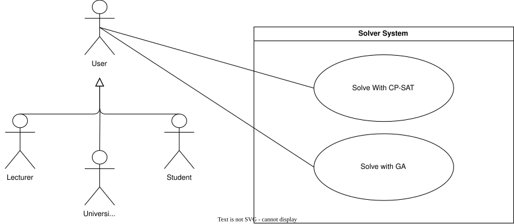
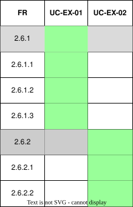

??? "**Solver System Use Cases**"
    <a id="solver-system-id"></a>
    <div align="center">

    ### **Use Case Table**
    | **Use Case ID** | **Use Case Name** | **Actor** |
    | :---: | :---: | :---: |
    | **UC-SV-01** | [Solve with CP-SAT](#uc-sv-01) | User |
    | **UC-SV-02** | [Solve with GA](#uc-sv-02) | User |

    </div>

    ??? tip "**Use Case Diagram**"
        

    ??? warning "**Traceability Matrix**"
        <div align="center">
        
        </div>

    ---
    ??? "UC-SV-01: Solve with CP-SAT"
        <a id="uc-sv-01"></a>
        ##### High Level
        ```
        Solve with CP-SAT (Actor: User, Solver Service)
            TUCBW the user requests a timetable without enabled preferences.
            TUCEW the system uses CP-SAT to select the required number of events without time overlaps, or falls back to GA when CP-SAT reports infeasibility.
        ```

        ##### Expanded
        | Field | Detail |
        | :--- | :--- |
        | **Actor** | User |
        | **Precondition** | A finalised set of events exists (received via the Builder, PDF Upload, or University API adapter) |
        | **Trigger** | User requests timetable creation after reviewing events. |
        | **Basic Flow** | 1. System submits the event IDs with engine `auto`.<br>2. The worker runs CP-SAT.<br>3. CP-SAT enforces selection counts and prevents time overlaps.<br>4. System stores the result and the browser polls for completion.<br>5. The frontend creates the timetable from the selected event IDs. |
        | **Alternate Flow** | **A1: No feasible solution found**<br>System automatically triggers [Solve with GA](#uc-sv-02) to generate a best-effort schedule.<br><br>**A2: Solver error or timeout**<br>System logs the failure and notifies the User that scheduling could not be completed. |
        | **Postcondition** | A conflict-free result is available for timetable creation, or GA has been triggered. |
        | **Requirements Covered** | R2.6.1 \| R2.6.1.1 \| R2.6.1.2 |

    ---
    ??? "UC-SV-02: Solve with GA"
        <a id="uc-sv-02"></a>
        ##### High Level
        ```
        Solve with GA (Actor: User, Solver Service)
            TUCBW the user enables preferences or CP-SAT reports infeasibility in automatic mode.
            TUCEW the system uses a Genetic Algorithm, applying selection, crossover, and mutation across generations and guided by the User's soft preferences (target time, minimal gaps, skip day), to generate the best-available schedule and notifies the User of the result along with any remaining conflicts.
        ```
        ##### Expanded
        | Field | Detail |
        | :--- | :--- |
        | **Actor** | User |
        | **Precondition** | Events are available and preferences are enabled, or CP-SAT has reported infeasibility. |
        | **Trigger** | The frontend requests engine `ga` for preferences, or automatic mode falls back from CP-SAT. |
        | **Basic Flow** | 1. System receives the finalised set of events and the User's soft preferences (target time, minimal gaps, skip day).<br>2. System initialises a population of candidate schedules.<br>3. System evaluates each candidate's fitness based on hard-constraint violations and how well it satisfies the soft preferences.<br>4. System applies selection, crossover, and mutation operators across successive generations to improve candidate schedules.<br>5. System converges on the candidate schedule with the lowest violation score, once a maximum generation count or convergence threshold is reached.<br>6. System stores the result and the browser polls for completion.<br>7. The frontend creates the timetable from the selected event IDs. |
        | **Alternate Flow** | **A1: No improvement across generations**<br>System returns the best schedule found and flags it as best-effort with conflicts still present. |
        | **Postcondition** | A best-effort schedule, optimised against the User's soft preferences with conflicts minimised, is generated and available for the User to view, edit, or delete |
        | **Requirements Covered** | R2.6.1.3 \| R2.6.1.4 \| R2.6.1.5 \| R2.6.2 \| R2.6.2.1 \| R2.6.2.2 \| R2.6.2.3 \| R2.6.2.4 |