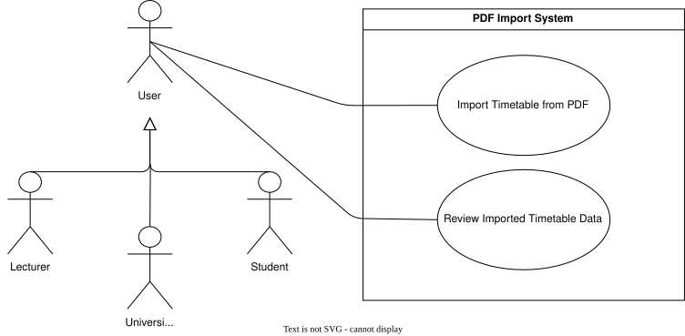
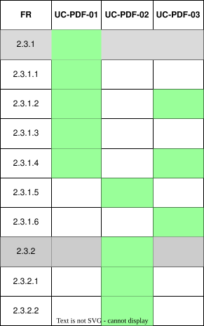

??? "**Timetable Creation (PDF System) Use Cases**"
    <a id="pdf-system"></a>
    <div align="center">

    ### **Use Case Table**
    | **Use Case ID** | **Use Case Name** | **Actor** |
    | :---: | :---: | :---: |
    | **UC-PDF-01** | [Import Timetable from PDF](#uc-pdf-01) | User |
    | **UC-PDF-02** | [Review Imported Timetable Data](#uc-pdf-02) | User |
    | **UC-PDF-03** | [Verify Imported Data](#uc-pdf-03) | University Admin |

    </div>

    ??? tip "**Use Case Diagram**"
        

    ??? warning "**Traceability Matrix**"
        <div align="center">
        
        </div>

    ---
    ??? "UC-PDF-01: Import Timetable from PDF"
        <a id="uc-pdf-01"></a>
        ##### High Level
        ```
        Import Timetable from PDF (Actor: User, System: PDF Parser)  
            TUCBW the user uploads a university-provided timetable PDF into the system.  
            TUCEW the system parses the PDF, identifies modules and events, and maps them to existing records or creates new ones where required.
        ```
        ##### Expanded
        | Field | Detail |
        | :--- | :--- |
        | **Actor** | User |
        | **Precondition** | User is authenticated |
        | **Trigger** | User selects “Import Timetable” and uploads a PDF |
        | **Basic Flow** | 1. User uploads a supported university timetable PDF.<br>2. System validates the file and queues parsing.<br>3. The worker returns extracted modules and events.<br>4. System imports or reuses records and completes the job.<br>5. The browser polls the job and displays the imported activities. |
        | **Alternate Flow** | **A1: Invalid file format**<br>System rejects upload and prompts correct format.<br><br>**A2: Parsing failure**<br>System notifies user and aborts import process.<br><br>**A3: Partial extraction**<br>System imports what is possible and flags missing data for review. |
        | **Postcondition** | Modules and events are stored and available for review. |
        | **Requirements Covered** | R2.3.1 \| R2.3.1.1 \| R2.3.1.2 \| R2.3.1.3 \| R2.3.1.4 |

    ---
    ??? "UC-PDF-02: Review Imported Timetable Data"
        <a id="uc-pdf-02"></a>
        ##### High Level
        ```
        Review Imported Timetable Data (Actor: User, System: Timetable Import)  
            TUCBW the user reviews the extracted timetable data generated from the PDF.  
            TUCEW the system presents the parsed modules and events for selection and confirmation.
        ```
        ##### Expanded
        | Field | Detail |
        | :--- | :--- |
        | **Actor** | User |
        | **Precondition** | A successful PDF import has been completed |
        | **Trigger** | System displays imported timetable preview |
        | **Basic Flow** | 1. System displays the imported modules and events.<br>2. User confirms the activities.<br>3. User names the timetable and chooses preferences.<br>4. System submits a solver job and polls its status.<br>5. System creates the timetable from the selected event IDs and opens My Schedules. |
        | **Alternate Flow** | **A1: User leaves the flow.**<br>Imported modules and events remain stored.<br><br>**A2: Solving fails.**<br>System displays the failure and allows another attempt. |
        | **Postcondition** | A timetable is created from the solver result. Imported records already exist before timetable creation. |
        | **Requirements Covered** | R2.3.1.5 \| R2.3.2 \| R2.3.2.1 \| R2.3.2.2 |

    ---
    ??? "UC-PDF-03: Verify Imported Data"
        <a id="uc-pdf-03"></a>
        ##### High Level
        ```
        Verify Imported Data (Actor: University Admin, System: PDF Parser)  
            TUCBW a university admin reviews module/event data imported from a PDF for their university.  
            TUCEW the admin reviews stored events and updates their validation status.
        ```
        ##### Expanded
        | Field | Detail |
        | :--- | :--- |
        | **Actor** | University Admin |
        | **Precondition** | Actor is an approved uni_admin and imported events exist for the university. |
        | **Trigger** | Uni_admin opens an imported event for review. |
        | **Basic Flow** | 1. System displays the imported event.<br>2. Uni_admin checks its details against the source document.<br>3. Uni_admin edits permitted fields and updates the validation flag.<br>4. System saves the event. |
        | **Alternate Flow** | **A1: Data is not verified.**<br>The event remains stored with its validation flag unset. |
        | **Postcondition** | The stored event has an updated validation status. |
        | **Requirements Covered** | R2.3.1.2 \| R2.3.1.4 \| R2.3.1.6 |